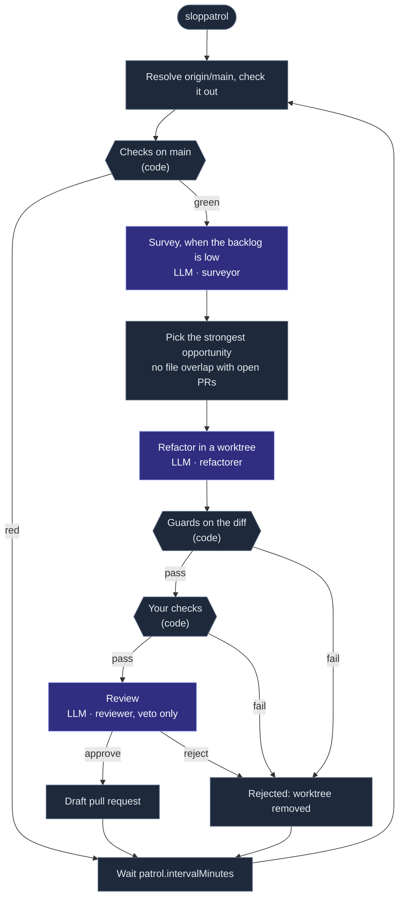

# Sloppatrol

Sloppatrol is a team of agents that patrols your repo all day and makes the code cleaner, one small pull request at a time. It never changes what the code does.

It is the code-quality sibling of [Bugpatrol](https://github.com/agent-labs-dev/bugpatrol) and [Speedpatrol](https://github.com/agent-labs-dev/speedpatrol): one `.sloppatrol/` folder, agent roles on any agent runtime, a patrol loop, a live dashboard, and GitHub pull requests.

- The **surveyor** reads the code and records **opportunities**: shallow modules, mixed concerns, hidden dependencies, deep imports, duplicated owners, dead code, tests that mock the team's own code.
- The **refactorer** makes one opportunity real, in its own git worktree.
- The **gate** is code, not a model. It decides what is kept: guards on the diff, then every check of your repo.
- The **assessor** scores code against a rubric of seven quality metrics: for the repo's scorecard, and blind, before and after, for every refactor.
- The **reviewer** reads a change that passed the gate. It can only reject.
- Each verified refactor becomes a draft pull request.

```bash
npx sloppatrol init
npx sloppatrol
```

## Why you can trust a refactor

An agent proposes; code decides. A refactor is kept only when every step below passes, and no agent can overrule one.

| Step | What it checks |
| --- | --- |
| One side | A **source** refactor changes no test file, so your existing tests prove the behaviour held. A **tests** refactor changes no source file, so the unchanged source proves the new tests right. |
| Frozen files | No manifest, lockfile, tool config, CI file, snapshot or `.env` changes. No path in `ignore`. |
| No suppression | No added `@ts-ignore`, `eslint-disable`, `# type: ignore`, `as any`, coverage exclusion, or skipped or focused test. A suppression that moves with its code is fine. |
| Tests kept | The diff removes no test case, and changes no test file that no check runs (`uncheckedTests`). |
| Size | At most `guards.maxFiles` files and `guards.maxLines` lines. |
| Checks | Every command in `checks` passes, as it passes on `main`. Sloppatrol does no work while `main` is red. |
| Review | A reviewer agent reads the diff against the playbook, and rejects when in doubt. |

| Mutation | A **tests** refactor plants one bug in the unchanged source; a test check must turn red. A test that cannot fail proves nothing. |
| Improvement | The assessor scores the changed files before and after, blind. The target metrics must go up; no other metric may drop. |

So the stronger your tests, the more Sloppatrol can do. Each check must run the same work on `main` and on every refactor: a command that picks its tests from the diff (`--changed`, `affected`) runs less on `main`, so a failure on a refactor can be old. `sloppatrol doctor` warns about such a check. Where code has no tests, the surveyor proposes **characterization tests** first: tests that pin what the code does today. To move a test from a mocking library to a fake, it makes two refactors: `inject-dependency` (source: add a seam, with today's behaviour as the default), then `replace-mock` (tests: inject a fake through the seam).

## The metrics

An assessor agent scores each file against a fixed rubric, and cites the lines behind each score. For each metric it picks one of five anchored levels, and Sloppatrol shows the result as 0 (worst) to 100 (best): a level of 3 is 75. A scorecard also shows one **overall** score, the mean of all metrics. The rubric anchors every level in things a reader can point at, so scores stay consistent ([ADR 0004](docs/adr/0004-llm-judged-metrics.md)).

| Metric | The question |
| --- | --- |
| Simplicity | Can a reader follow each function without holding much in their head? |
| Modularity | Does the file own one concept, behind a small interface, apart from other concerns? |
| Injection | Does the code receive what it depends on, or reach out for it? |
| Purity | How much of the logic lives in pure functions (same input, same output, no side effects), with state and effects kept small and at the edge? |
| Test quality | Do the tests prove behaviour through the interface, and would they fail if it broke? |
| Clarity | Does every name, comment and abstraction earn its place? |
| Agent-friendliness | How hard is it for an agent to change this file wrong, and is it a pattern worth copying? |

The scorecard also checks the repo's own guardrails, from files alone: an agent guide, strict types, a linter, module boundary rules, a pre-commit hook, CI and tests. Each one turns a wrong edit into a failed check. Sloppatrol reports a missing one; it never adds one itself, because tool configs are frozen.

Each commit gets a **scorecard** of the whole repo. A file keeps its scores while its content does not change, and each cycle scores up to `metrics.panel` more files: the most changed first, then the largest. So coverage grows each cycle until every file is scored, and the scorecard shows how much it covers. Every mean is weighted by lines. The surveyor starts from the worst scores, and each opportunity names the metrics it will raise. `sloppatrol score --files 200` scores more now; the dashboard shows the trend.

## The proof

Every pull request carries its proof, built by code and by a blind assessor, never by the agent that wrote the change:

- **It breaks nothing:** the side it changed, the guards it passed, the same checks green on `main` and on the change (with the test counts), and for a tests refactor, the planted bug its tests caught.
- **It makes the code better:** each metric before and after, the target marked, and the measured lines, nesting, comments, mocks and suppressions.
- **It follows the repo's rules:** the rule files read, and the reviewer's account of each rule that applies.

## Your repo's rules

Every agent reads your repo's own rules before it acts, and they win over the playbook: `.sloppatrol/instructions.md`, every `AGENTS.md` and `CLAUDE.md` from the repo root down to the changed files (with their `@path` imports), `CONTRIBUTING.md`, `CODING_STANDARDS.md`, `GLOSSARY.md`, and the titles of your decision records. `sloppatrol doctor` lists what it found.

## The playbook

The agents follow a [playbook](playbook/) of top-tier engineering practice, written for agents:

- [Principles](playbook/principles.md): deep modules, seams, ports and adapters, one owner per concept, separation of concerns, dependency injection, single responsibility, small files, no sediment. The vocabulary comes from Ousterhout, Feathers, Fowler, and [Matt Pocock's skills](https://github.com/mattpocock/skills).
- [Testing](playbook/testing.md): test through the interface; fakes injected through a seam, never a mocking library for your own code.
- [Smells](playbook/smells.md) and [Safety](playbook/safety.md): what to look for, and the behaviour a refactor must keep.
- One page per stack, picked from what the census detects: [TypeScript](playbook/stacks/typescript.md), [React and React Native](playbook/stacks/react.md), [Node backends](playbook/stacks/node-backend.md), [Python](playbook/stacks/python.md), [Go](playbook/stacks/go.md), [Swift](playbook/stacks/swift.md), [Kotlin](playbook/stacks/kotlin.md), [Rust](playbook/stacks/rust.md).

Your repo's own rules win over the playbook: `.sloppatrol/instructions.md`, `CLAUDE.md`, `AGENTS.md`, `CONTRIBUTING.md`, `GLOSSARY.md`, and the decision records in `docs/adr/`.

## Commands

```text
Start
  sloppatrol init              Create .sloppatrol/ with a guess at your checks
  sloppatrol doctor            Show the config, the agent each role runs on, and what is missing

Run
  sloppatrol                   Patrol all day: a cycle every patrol.intervalMinutes, with the dashboard
  sloppatrol --once            One cycle, then stop
  sloppatrol dashboard         Only the dashboard (http://127.0.0.1:4322)

One step at a time
  sloppatrol check             Run your checks on the patrolled commit (the oracle)
  sloppatrol survey            Let the surveyor record opportunities now
  sloppatrol refactor [id]     Attempt one opportunity now: the best open one, or <id>
  sloppatrol score             Score the repo now: the metrics of the panel of files
  sloppatrol publish           Open pull requests for verified refactors (--dry-run)

Read
  sloppatrol status            The opportunities, the refactors and the agents
  sloppatrol census            What the surveyor sees: stack, large files, mocks, churn
  sloppatrol dismiss <id>      Never propose this opportunity again (--reason "...")
```

## A cycle



- A merged pull request finishes its opportunity. A closed one dismisses it for good.
- At most `github.maxOpen` pull requests wait at once, and two never touch the same file.
- An opportunity that fails the gate `maxAttempts` times is exhausted.

## The dashboard

`sloppatrol` serves a dashboard on `http://127.0.0.1:4322` while it patrols (`--no-dashboard` turns it off; `sloppatrol dashboard` serves it alone). It shows, live:

- **Agents**: what the patrol, the surveyor, the refactorer, the gate and the reviewer do now.
- **Refactors**: each attempt as a pipeline (refactorer → guards → checks → mutation → metrics → review → pull request), with its full proof.
- **Scorecard**: each metric's score and trend over commits, and every file of the panel with the evidence behind its scores.
- **Checks**: every check run on `main`, on each refactor, and each run the refactorer starts itself, with the output of each check.
- **Backlog**: the opportunities by status, with the problem, the change and the files.
- **Sessions**: every agent session as a timeline of its tool calls.

## Any agent, any model

By default every role runs on the agent CLI you have installed: `agent: auto` picks `claude`, then `codex`, then `opencode`, from your `PATH`. The surveyor and the reviewer get read-only access; the refactorer gets edit access in its own worktree. Every role reaches Sloppatrol through its tools over a local MCP server.

```yaml
agent: auto                       # or claude | codex | opencode
agents:
  reviewer: { use: codex }        # a second opinion from another agent
  surveyor:
    use: { runtime: model, via: openrouter, model: anthropic/claude-opus-5.5 }
```

`{ runtime: model, via: anthropic | openai | openrouter | custom, model }` runs Sloppatrol's own tool loop on an API key. `{ runtime: cli, command: "..." }` runs any command, with `{prompt}`, `{mcp}`, `{mcpUrl}` and `{workdir}` filled in.

## Configuration

```yaml
# .sloppatrol/sloppatrol.yml
agent: auto
prepare: [pnpm install --frozen-lockfile]   # each fresh checkout and worktree
checks:                                     # the oracle
  - { name: typecheck, run: pnpm typecheck }
  - { name: lint, run: pnpm lint }
  - { name: test, run: pnpm test, tests: true }   # tests: true marks the checks a planted bug must turn red
focus: [src/**]                             # where the surveyor looks (default: everywhere)
ignore: [src/generated/**]                  # what no agent may change
uncheckedTests: [tests/e2e/**]              # tests no check runs: no refactor may change them
guards: { maxFiles: 12, maxLines: 600 }
metrics: { enabled: true, panel: 100, tolerance: 0.5, judges: 3 }   # panel: files newly scored per cycle
agents:
  surveyor: { minBacklog: 3, maxPerSurvey: 8 }
  refactorer: { maxPerCycle: 1, maxAttempts: 2 }
  reviewer: { enabled: true }
github: { enabled: true, draft: true, maxOpen: 3, labels: [sloppatrol] }
patrol: { intervalMinutes: 60, pull: origin/main }
```

Every role also takes `maxSteps`, `timeoutMinutes` and `budgetUsd` (model runtime). Pull requests open with your `gh` login.

`.sloppatrol/sloppatrol.yml` and `.sloppatrol/instructions.md` are committed. `.sloppatrol/runs/` holds local data (checkouts, worktrees, opportunities, refactors, check runs, sessions) as plain JSON, and git ignores it.

## Docs

- [Glossary](GLOSSARY.md)
- [Decisions](docs/adr/): why it works this way.

## Development

```bash
pnpm install
pnpm build
pnpm test
pnpm check      # Biome, module boundaries (dependency-cruiser), types
pnpm knip
```

Sloppatrol follows its own playbook: each folder in `src/` is a deep module, other modules reach it only through its root files, the CLI is the only composition root, and the tests use real git repos, real processes, an in-memory GitHub and a scripted agent, with no mocking library.

## License

Apache-2.0
