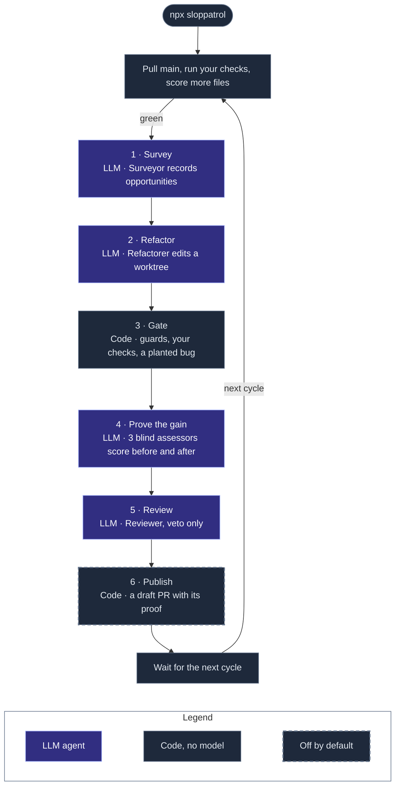
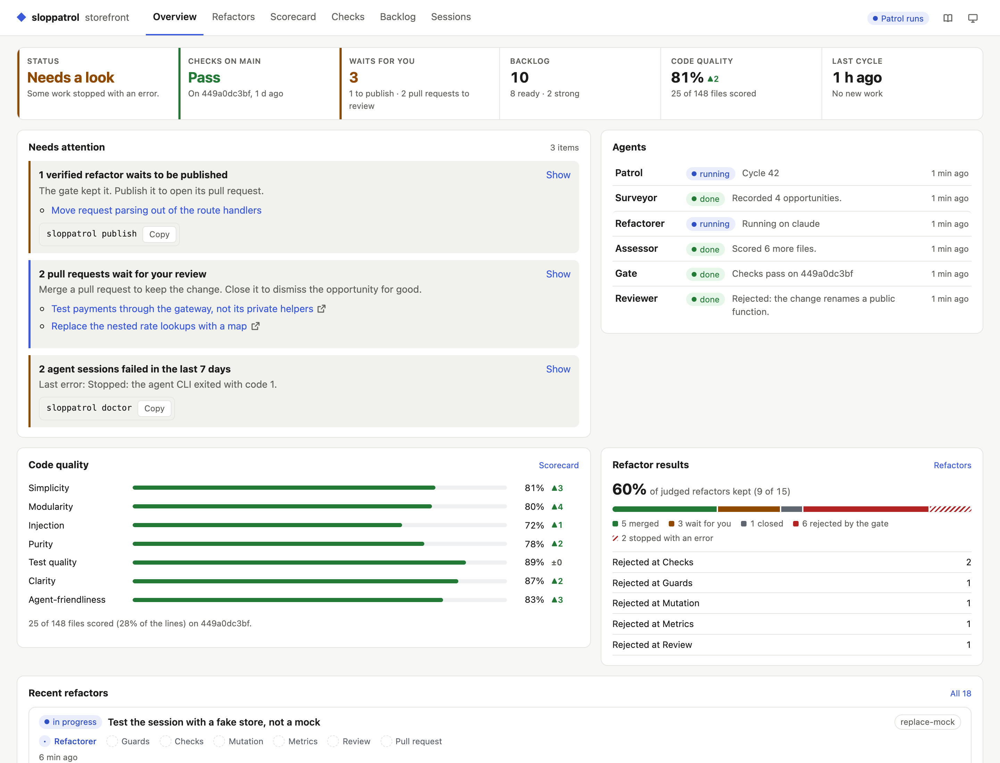

<p align="center">
  
</p>

<p align="center">
  <a href="https://www.npmjs.com/package/sloppatrol"></a>
  <a href="https://github.com/agent-labs-dev/sloppatrol/actions/workflows/ci.yml"></a>
  <a href="LICENSE"></a>
</p>

Sloppatrol is a team of agents that patrols your repo and makes the code cleaner, one small pull request at a time. It never changes what the code does, and each pull request carries the proof.

- A **surveyor** agent reads the code and records opportunities: shallow modules, mixed concerns, hidden dependencies, tests that mock your own code.
- A **refactorer** agent makes one opportunity real, in its own git worktree.
- The **gate** is code, not a model. It keeps a refactor only when your checks pass and a planted bug turns a test red.
- Three blind **assessor** agents score the code before and after, on seven quality metrics. The target metrics must go up.
- A **reviewer** agent reads the change against your repo's rules. It can only reject.

It is the code-quality sibling of [Bugpatrol](https://github.com/agent-labs-dev/bugpatrol) and [Speedpatrol](https://github.com/agent-labs-dev/speedpatrol).

```bash
npx sloppatrol
```

`npx sloppatrol` runs the patrol: survey, refactor, gate, prove, review, and publish, again and again. Verified refactors wait for `sloppatrol publish` until you turn on GitHub.

### How the patrol runs



[How it works](docs/how-it-works.md) shows each step of the gate, and the proof on each pull request.

## The dashboard

`npx sloppatrol` serves a live dashboard on http://127.0.0.1:4322. The **Scorecard** shows the quality of the whole repo: each metric, its trend, your repo's guardrails, and the score of each file.

<p align="center">
  
</p>

The dashboard also shows each refactor as a pipeline with its proof, every check run, the backlog, and every agent session. [The dashboard](docs/dashboard.md) tells more.

## Set up with your agent

1. Install the Sloppatrol skill in your repo:

   ```bash
   npx skills add agent-labs-dev/sloppatrol
   ```

   The [skills CLI](https://github.com/vercel-labs/skills) installs the skill for Claude Code, Codex, Cursor, and many other agents. It also writes `skills-lock.json` at the repo root. Commit both, so your team gets the skill too.

2. Give this prompt to your agent:

   ```text
   Set up Sloppatrol for this repo.
   ```

The [skill](skills/sloppatrol/SKILL.md) tells the agent what Sloppatrol does, how to configure the checks of your repo, how to run it, and how to read the results.

If your agent cannot install skills, give it the skill URL:

```text
Read https://raw.githubusercontent.com/agent-labs-dev/sloppatrol/main/skills/sloppatrol/SKILL.md and set up Sloppatrol for this repo.
```

To set it up by hand, read [Getting started](docs/getting-started.md).

## What is supported

| Area | Supported |
| --- | --- |
| Languages | Any language with checks that you can run from a shell. The playbook has pages for TypeScript, React and React Native, Node backends, Python, Go, Swift, Kotlin and Rust. |
| Agents | Claude Code, Codex or opencode, with your existing login (`agent: auto` picks the installed one). Or an API key for Anthropic, OpenAI, OpenRouter, or a custom endpoint. |
| Repo rules | `AGENTS.md`, `CLAUDE.md` and their `@` imports, `CONTRIBUTING.md`, `GLOSSARY.md`, and your decision records |
| GitHub | Draft pull requests through the `gh` CLI |
| Output | A local dashboard, GitHub pull requests, and JSON files under `.sloppatrol/runs/` |

## Documentation

| Page | What it covers |
| --- | --- |
| [Getting started](docs/getting-started.md) | Add Sloppatrol to your repo, step by step |
| [How it works](docs/how-it-works.md) | The cycle, the gate, the proof, your repo's rules, and the playbook |
| [The metrics](docs/metrics.md) | The seven metrics, the rubric, and how the scorecard grows |
| [Commands](docs/commands.md) | All the CLI commands |
| [Configuration](docs/configuration.md) | All the settings in `.sloppatrol/sloppatrol.yml` |
| [Agents and models](docs/models.md) | The agent of each role, and the model providers |
| [The dashboard](docs/dashboard.md) | What each tab shows |
| [Playbook](playbook/principles.md) | The engineering practice that the agents follow |
| [Glossary](GLOSSARY.md) | The words Sloppatrol uses, with one meaning each |
| [Decisions](docs/adr/) | Why Sloppatrol works this way |
| [Contributing](CONTRIBUTING.md) | Build Sloppatrol from source, the shape of the code, and releases |

## License

[Apache-2.0](LICENSE)

---

<p align="center">Made with ❤️ by the <a href="https://nebula.gg">Nebula</a> team.</p>
