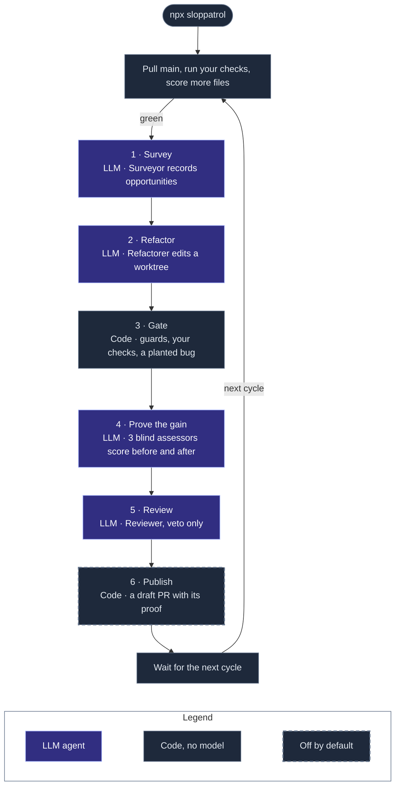

# How it works

An agent proposes; code decides. This page shows the cycle, the gate that decides what is kept, the proof on each pull request, and the rules the agents follow.

## A cycle

- A refactor fails the gate at the first step that fails, and Sloppatrol removes its worktree.
- A merged pull request finishes its opportunity. A closed one dismisses it for good.
- At most `github.maxOpen` pull requests wait at once, and two never touch the same file.
- An opportunity that fails the gate `maxAttempts` times is exhausted.

## Why you can trust a refactor

An agent proposes; code decides. A refactor is kept only when every step below passes, and no agent can overrule one.

| Step | What it checks |
| --- | --- |
| One side | A **source** refactor changes no test file, so your existing tests prove the behaviour held. A **tests** refactor changes no source file, so the unchanged source proves the new tests right. |
| Frozen files | No manifest, lockfile, tool config, CI file, snapshot or `.env` changes. No path in `ignore`. |
| No suppression | No added `@ts-ignore`, `eslint-disable`, `# type: ignore`, `as any`, coverage exclusion, or skipped or focused test. A suppression that moves with its code is fine. |
| Tests kept | The diff removes no test case, and changes no test file that no check runs (`uncheckedTests`). |
| Size | At most `guards.maxFiles` files and `guards.maxLines` lines. |
| Checks | Every command in `checks` passes, as it passes on `main`. Sloppatrol does no work while `main` is red. |
| Mutation | A **tests** refactor plants one bug in the unchanged source; a test check must turn red. A test that cannot fail proves nothing. |
| Improvement | The assessor scores the changed files before and after, blind. The target metrics must go up; no other metric may drop. |
| Review | A reviewer agent reads the diff against the playbook, and rejects when in doubt. |

So the stronger your tests, the more Sloppatrol can do. Each check must run the same work on `main` and on every refactor: a command that picks its tests from the diff (`--changed`, `affected`) runs less on `main`, so a failure on a refactor can be old. `sloppatrol doctor` warns about such a check. Where code has no tests, the surveyor proposes **characterization tests** first: tests that pin what the code does today. To move a test from a mocking library to a fake, it makes two refactors: `inject-dependency` (source: add a seam, with today's behaviour as the default), then `replace-mock` (tests: inject a fake through the seam).

## The proof

Every pull request carries its proof, built by code and by a blind assessor, never by the agent that wrote the change:

- **It breaks nothing:** the side it changed, the guards it passed, the same checks green on `main` and on the change (with the test counts), and for a tests refactor, the planted bug its tests caught.
- **It makes the code better:** each metric before and after, the target marked, and the measured lines, nesting, comments, mocks and suppressions.
- **It follows the repo's rules:** the rule files read, and the reviewer's account of each rule that applies.

## Your repo's rules

Every agent reads your repo's own rules before it acts, and they win over the playbook: `.sloppatrol/instructions.md`, every `AGENTS.md` and `CLAUDE.md` from the repo root down to the changed files (with their `@path` imports), `CONTRIBUTING.md`, `CODING_STANDARDS.md`, `GLOSSARY.md`, and the titles of your decision records. `sloppatrol doctor` lists what it found.

## The playbook

The agents follow a [playbook](../playbook/) of top-tier engineering practice, written for agents:

- [Principles](../playbook/principles.md): deep modules, seams, ports and adapters, one owner per concept, separation of concerns, dependency injection, single responsibility, small files, no sediment. The vocabulary comes from Ousterhout, Feathers, Fowler, and [Matt Pocock's skills](https://github.com/mattpocock/skills).
- [Testing](../playbook/testing.md): test through the interface; fakes injected through a seam, never a mocking library for your own code.
- [Smells](../playbook/smells.md) and [Safety](../playbook/safety.md): what to look for, and the behaviour a refactor must keep.
- One page per stack, picked from what the census detects: [TypeScript](../playbook/stacks/typescript.md), [React and React Native](../playbook/stacks/react.md), [Node backends](../playbook/stacks/node-backend.md), [Python](../playbook/stacks/python.md), [Go](../playbook/stacks/go.md), [Swift](../playbook/stacks/swift.md), [Kotlin](../playbook/stacks/kotlin.md), [Rust](../playbook/stacks/rust.md).

Your repo's own rules win over the playbook.

[The metrics](metrics.md) shows the rubric that the assessor uses. [Decisions](adr/) tell why it works this way.
